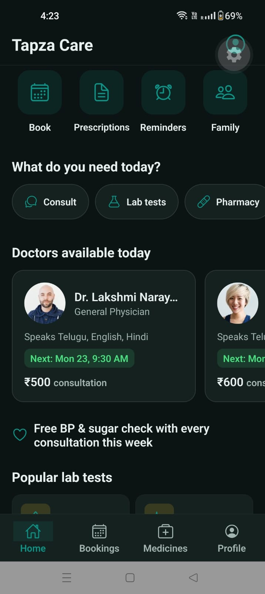
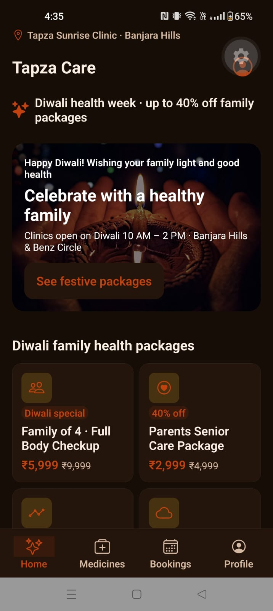
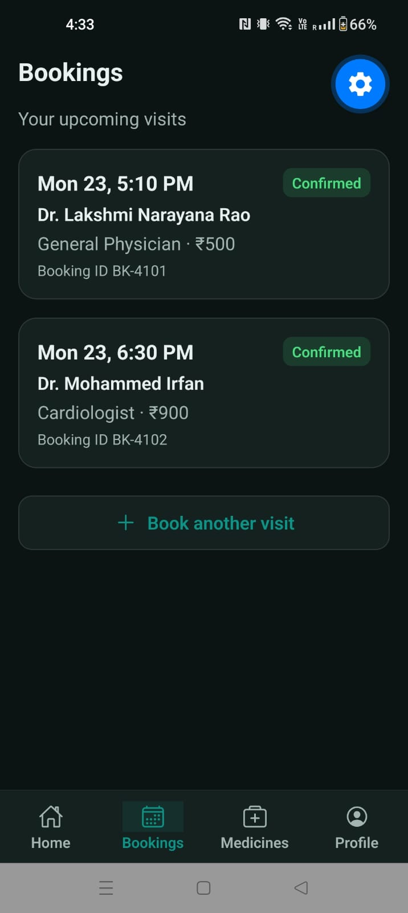
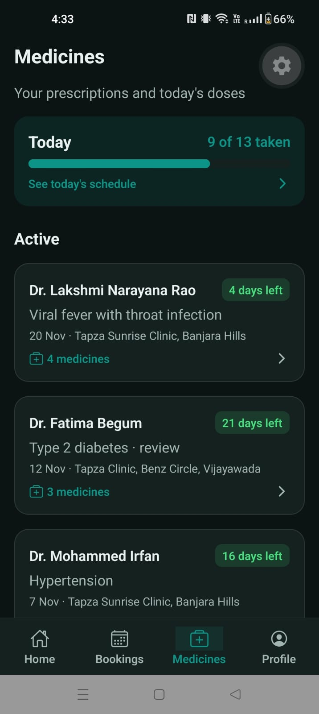

# Tapza Care

The patient app for Tapza Clinic: a config-driven home screen (with a Diwali
theme that switches at runtime), booking a doctor or lab test, and
prescriptions with a daily medicine schedule. React Native + Expo, TypeScript
(strict), with a mock backend inside the app.

| Normal day | Diwali | Booking | Medicines |
|---|---|---|---|
|  |  |  |  |

Demo video: [docs/tapza-app.mp4](docs/tapza-app.mp4)

---

## Install the app (Android)

**Download:** [Expo build page](https://expo.dev/accounts/dev_raman/projects/tapza-care/builds/9e732b5c-6e05-4f4a-b6e5-f1482862f632) (tap **Install** on an Android phone) · or the APK on **[GitHub Releases](../../releases)**

1. Open one of the links above on your Android phone and download the APK (on Releases it's `tapza-care.apk`).
2. Open the file. If Android asks, allow installing apps from this source (Chrome or Files).
3. Open **Tapza Care**. No account or server is needed; the backend is built in.

## Run it locally

Needs Node 20+ and the **Expo Go** app on an Android phone (same Wi-Fi as the computer).

```bash
npm install
npx expo start          # scan the QR code with Expo Go
```

Other commands:

```bash
npm test                # Jest: 28 tests
npm run typecheck       # tsc --noEmit
npm run lint            # expo lint
npm run web             # quick look in a browser (no gestures, haptics or notifications)
```

Build the APK yourself (needs a free Expo account):

```bash
npx eas-cli@latest build -p android --profile preview
```

This uses the `preview` profile in `eas.json`, which builds an installable `.apk`
(the `production` profile builds a Play Store bundle instead).

## Trying the features

Open **Profile → Demo controls**. They change how the built-in backend behaves, so
every case in the brief can be shown without touching code:

| Control | What it shows |
|---|---|
| Home config: Normal day / Diwali | Colours, banner, tab order, section order and items all change |
| Network speed: Fast / Slow 2.5s / Very slow 6s | Skeleton loaders shaped like the real content |
| Server failures: Config fails / Flaky 30% / All fail | Home keeps the last good config with a "Retry" note; other screens show error states |
| Offline | Every request fails as if there were no signal |
| Empty lists | Designed empty states for doctors, slots and prescriptions |
| Next booking: slot taken | The next confirm gets a 409: "That time was just taken" |

Also in Profile: **language** (English / हिन्दी / తెలుగు) and **appearance** (phone setting / light / dark).

Deep links work too, e.g. `tapzacare://prescription/rx-1042` or `tapzacare://book/d1`.

---

## Folder structure

```
src/
  app/            Routes (Expo Router). One-line files that point at a view.
  features/       One folder per area of the app. Each has view/ for its screens.
    home/view/        HomeView, SectionRenderer, sections/ (the 6 section types)
    bookings/view/    Bookings tab, doctor list, booking screen, confirmation
    prescriptions/view/  Medicines tab, prescription detail, today's reminders
    profile/view/     Language, appearance, demo controls
  components/     Shared UI used by more than one screen (AppText, Button, BottomSheet, ...)
  api/            endpoints.ts + client.ts, and mock/ (the fake backend and its data)
  config/         The /config contract: types, validation, loading and saving
  theme/          Colours from the config, sizes, ThemeProvider
  store/          Data saved on the phone (Zustand): settings, bookings, doses taken
  i18n/           English, Hindi and Telugu text
  utils/          Small helpers: dates, prices, prescription maths, notifications
__tests__/        Jest tests
```

**Why this shape:** screens live with their feature, everything reused lives in one
shared place, and `src/app` only says which URL opens which screen. Every folder
has an `index.ts`, so screens import from `@/components`, `@/utils` and so on.
Files inside a folder import each other directly (`./AppText`) to avoid import loops.

---

## How it works

**Config-driven home.** `ConfigProvider` fetches `GET /config`, checks it with
`config/validate.ts`, saves it as the last good config, and renders. If the fetch
fails, the app shows the saved config (or one bundled in the app on a first launch)
with a calm "Retry" note, never a blank screen. Validation rejects a broken theme,
drops a single broken section, and **keeps unknown section types**; `SectionRenderer`
looks the type up in a table and renders nothing if it doesn't know it, and each
section has its own error boundary. So an older app ignores section types added later.

**Theme.** The 7 config colours are used as sent, plus a few lighter tints made by
adding transparency. Dark-mode colours come from the config's `dark` palette.
All hard-coded colours live in one file, `theme/colors.ts`. Components get colours,
spacing and font sizes from `useTheme()`.

**Mock backend.** `api/mock/server.ts` answers the five endpoints from the brief
inside the app, with one plain function per endpoint. Booked slots are kept in
memory, so booking the same slot twice returns a real 409. `api/client.ts` is the
only file that knows the backend is fake; using a real server means changing that
one call to `fetch`.

**Data.** Server data goes through **TanStack Query** (loading, errors, retry,
caching). Data saved on the phone uses small **Zustand** stores (settings, last
config, bookings, doses taken). No Redux: there's very little app state left over.

**Booking (optimistic).** Confirm adds the booking as "confirming" and opens the
confirmation screen straight away. When the server answers it becomes "confirmed",
or "failed" (slot taken / no answer), and the screen updates by itself. The slot
picker is a bottom sheet built with Gesture Handler + Reanimated; the drag runs on
the UI thread.

**Prescriptions.** Today's doses come from each medicine's timing and number of
days, so a 3-day medicine drops off on day 4. "Taken" is saved per day (the date is
part of the key). **Remind me** schedules a daily local notification at 8 AM / 2 PM /
9 PM for the times that have medicines.

**Animations.** Header shrink, banner parallax, sections fading in as they scroll
into view, the slot sheet and the confirmation icon all use Reanimated and only
change opacity and position, which is cheap on mid-range Android phones. Section
reveal is skipped when the phone's "reduce motion" setting is on.

**Accessibility.** OS font scaling is respected (capped at 1.6×), tap targets are at
least 48pt, buttons and rows have screen-reader labels, and text sizes start a
little larger than usual because many users are older.

**Languages.** `i18n/` has one file per language; TypeScript fails the build if
Hindi or Telugu misses a key. Weekday and month names follow the chosen language.
Content from the server or config (doctor names, medicines, section titles) is
not translated by the app; a real backend would send it translated.

## Tests

| File | What it checks |
|---|---|
| `validateConfig.test.ts` | Good config passes; bad colours fail; broken sections and duplicates are dropped; unknown types are kept |
| `SectionRenderer.test.tsx` | A section renders; an unknown section type renders nothing and doesn't crash |
| `bookingStore.test.ts` | Confirming → confirmed; 409 → slot taken; offline → failed |
| `mockServer.test.ts` | 201 then 409 on the same slot, Sunday closed, failure / empty / offline switches, both configs valid |
| `prescriptions.test.ts` | Course day, finished medicines dropping off, marking a dose |
| `i18n.test.ts` | Values fill in; no empty or mismatched translations |

---

## Brief checklist

| Requirement | Where |
|---|---|
| Home from `GET /config`: theme, tabs, ordered sections with their own backgrounds | `config/`, `features/home/` |
| 6 section types, parallax hero, sections animate in, header shrinks | `features/home/view/sections/`, `components/HomeHeader.tsx`, `RevealOnScroll.tsx` |
| Normal + Diwali configs switchable at runtime; unknown type renders nothing | `api/mock/data/configs.ts`, Demo controls |
| Booking: date, slot in a gesture bottom sheet, confirm, success animation, optimistic | `features/bookings/`, `components/BottomSheet.tsx`, `store/bookings.ts` |
| Prescriptions: list, detail, morning / afternoon / night, mark dose taken | `features/prescriptions/`, `store/doses.ts` |
| Latency and failure switch; cache last good config; skeletons shaped like content | `api/mock/controls.ts`, `config/configCache.ts`, `components/Skeleton.tsx` |

**Bonus done:** local notifications for reminders, Hindi and Telugu, dark mode from
the config, haptics, deep links, custom success animation.

## What I cut, and why

- **Offline booking queue.** Booking while offline shows "Couldn't book" with Try
  again instead of syncing later. Kept the booking flow simple and explainable.
- **In-app config editor.** Demo controls already switch configs at runtime.
- **Shared-element transitions.** Nice to have; time went to the core flows.
- **End-to-end tests (Detox / Maestro).** Unit and component tests cover the logic;
  the main flows were tested by hand.
- **Translated config content.** Section titles and offers stay English; that text
  should come translated from the backend.
- **Real photos for services.** Service cards use icons; doctor photos are
  placeholder portraits with initials as the fallback.

## Time spent

<!-- Fill in your honest numbers before submitting. -->

| | Hours |
|---|---|
| Planning and setup | _ |
| Home screen and config | _ |
| Booking flow | _ |
| Prescriptions and reminders | _ |
| Languages, polish, testing on a phone | _ |
| README, video, APK | _ |
| **Total** | _ |

## AI use

I used Claude Code throughout. [AI_LOG.md](AI_LOG.md) lists the prompts that shaped
the code, the AI output I rejected or changed, key decisions, and problems found
during review.
